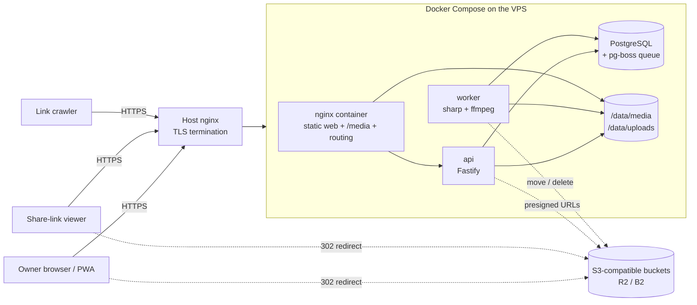
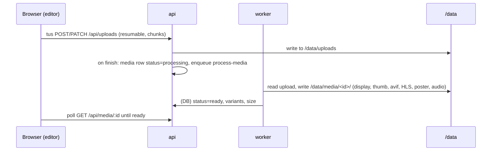

# Look Back — High-Level Design

Status: describes the system as built (October 2026). Companion: [detail-design.md](detail-design.md).

## 1. Purpose

Look Back is a private, single-owner web app for turning photos and videos into decorated albums — either a
**scrapbook** (paper, frames, tape, stickers, handwriting) or a **manga** (panels, speech bubbles, sound effects,
speed lines, screentone) — and flipping through them like a book. Albums can be shared read-only with a secret link.

It runs on one small VPS. Media can be offloaded to free S3-compatible buckets (Cloudflare R2, Backblaze B2) to get
past the VPS disk limit.

### Users

| Who | Can do |
|---|---|
| **Owner** (one password) | Everything: create/decorate/delete albums, upload, share, manage storage, back up. |
| **Share-link viewer** | View one album read-only (`/s/<token>`), including its photos, videos and music. |
| **Link crawler** (Facebook, Zalo…) | Gets an Open Graph preview (title, page count, cover image) for a share link. |

### Goals

- Decorating feels like a desk with paper and stickers; viewing feels like flipping a real book.
- Works well on phones (installable PWA, touch editing, offline viewing of what was opened).
- Large photos and long videos are fine: resumable uploads, background processing, adaptive video streaming.
- Cheap to run: one VPS + optional free buckets; nothing to babysit.
- Private by default: no media is ever public; share links are revocable.

### Non-goals

- Multiple user accounts, collaboration, comments.
- Editing photos (filters, retouching) beyond crop / ink / tone.
- Offline *editing* (offline is view-only).

## 2. System context

## 3. Building blocks

| Block | Tech | Responsibility |
|---|---|---|
| **web** | React 18, Vite, TypeScript | SPA: album list, editor, book viewer, share view, guide, print/PDF view, hidden `/manage` page. Service worker for offline viewing; update prompt on new builds. |
| **shared** | TypeScript + zod | One source of truth for the page layout schema (elements, frames, text, effects), templates, media DTOs — used by web and server. |
| **api** | Node 22, Fastify 5, pg | REST API, owner session auth, share links, tus upload endpoint, storage locations, presigned redirects for bucket media, backup stream, link previews. |
| **worker** | Node 22, pg-boss, sharp, ffmpeg | Processes uploads (image variants, video HLS renditions + poster, audio), moves media between storage locations, deletes bucket objects, cleans abandoned uploads. |
| **database** | PostgreSQL 16 | Albums, pages (layout as JSONB), media, storage locations, pending deletes; pg-boss job tables. |
| **nginx** (container) | nginx 1.27 | Serves the built web app, serves `/media/*` from disk behind an auth sub-request, proxies `/api/*`, routes crawlers to preview HTML, falls back to the api for media that live in buckets. |
| **object storage** (optional) | Any S3-compatible bucket | Holds media moved off the VPS. Private; reached only through short-lived presigned URLs. |

## 4. Key flows

### Upload and processing

The editor shows the picked file locally (object URL) while it uploads and processes; the frame then switches to the
real version.

### Viewing media

- **On the VPS disk:** nginx serves `/media/<id>/<file>` directly after an `auth_request` to the api (owner session or
  a share-link cookie for that album).
- **In a bucket:** the disk lookup misses, nginx hands the request to the api, which re-checks access and answers
  `302` to a presigned bucket URL (10 min). HLS playlists are served by the api; each segment request redirects.
- **Location down:** the browser's load fails and the frame shows a "crying face" placeholder.

### Sharing

Owner creates a share token (32 random bytes). `/s/<token>` loads the album read-only and sets a cookie that grants
access to that album's media only. Crawlers hitting `/s/<token>` get an Open Graph HTML page with a 1200×630 cover
image generated on the fly. Revoking clears the token.

### Storage management (`/manage`)

The owner adds buckets (keys encrypted at rest), sees disk/bucket usage, finds unused or failed files, deletes in bulk,
moves files between the VPS and buckets (background job: copy → verify → switch → delete source), and downloads a
full backup (`.tar` with database rows and every file, including bucket files). A restore command rebuilds everything
on the VPS.

## 5. Cross-cutting concerns

| Concern | Approach |
|---|---|
| **Auth** | One owner password (scrypt hash in env), encrypted session cookie, login rate limit. Share viewers get a scoped cookie. |
| **Privacy** | Every `/media` read is authorized (nginx sub-request or api check). Buckets are private; presigned URLs expire after 10 minutes. Bucket secret keys are AES-256-GCM encrypted and never leave the server or appear in backups. |
| **Reliability** | Resumable uploads (tus). Processing and moves run as queued jobs. Moves never delete the source before the copy is verified. Bucket deletions are queued and retried while a bucket is down. Autosave with retry in the editor. |
| **Performance** | Image variants (webp/avif, thumbnails, blur placeholders), adaptive HLS video, preloading neighbouring pages, lazy-loaded routes (`/manage`, dev tools), offline cache of viewed pages and photos. |
| **Mobile / PWA** | Installable manifest, touch editing (Moveable handles, pinch), phone toolbar layout, service worker, "new version" prompt driven by `/version.json`. |
| **Compatibility** | Container-query units compiled to CSS variables with a ResizeObserver polyfill (older iOS). |
| **Observability** | Fastify logs, pg-boss job state, media `status`/`error`/`move_error` columns surfaced on `/manage`. |

## 6. Deployment

- Images: `dastewasmiu/scrapbook-api`, `-worker`, `-nginx` on Docker Hub (built from one multi-stage Dockerfile).
- The VPS runs `docker compose -f compose.yml pull && up -d`. The api runs database migrations at start.
- nginx mode `behind-proxy` (default; the host's own nginx terminates TLS and forwards to `127.0.0.1:2611`) or
  `standalone` (the container terminates TLS itself).
- Secrets and settings come from `deploy/.env` (never committed). Optional template music is mounted read-only from
  `./template-music`.
- Backups: download from `/manage` and keep off the VPS; restore with `node server/dist/restore.js` in the api
  container.

## 7. Key decisions

| Decision | Why |
|---|---|
| Single owner, password only | Personal app; no account system to secure or maintain. |
| Layout stored as one JSONB document per page, validated by a shared zod schema | Editor and renderer share one model; schema changes are additive and optional fields keep old pages valid. |
| Manga mode reuses the same element types (frames, text, effects) with extra optional fields | One editor and renderer for both modes. |
| Process media up front (variants, HLS) | Fast, adaptive viewing on phones; originals kept for backup/restore. |
| nginx serves local media; api only for bucket media | No Node in the hot path for most bytes; buckets add no traffic through the VPS. |
| Presigned redirects instead of public buckets | Keeps media private without proxying bytes. |
| Manual moves between locations, uploads always to the VPS | Simple, predictable; processing needs local files. |
| Service worker caches what was viewed, nothing precached | Offline viewing without making viewers download code or media they never open. |
